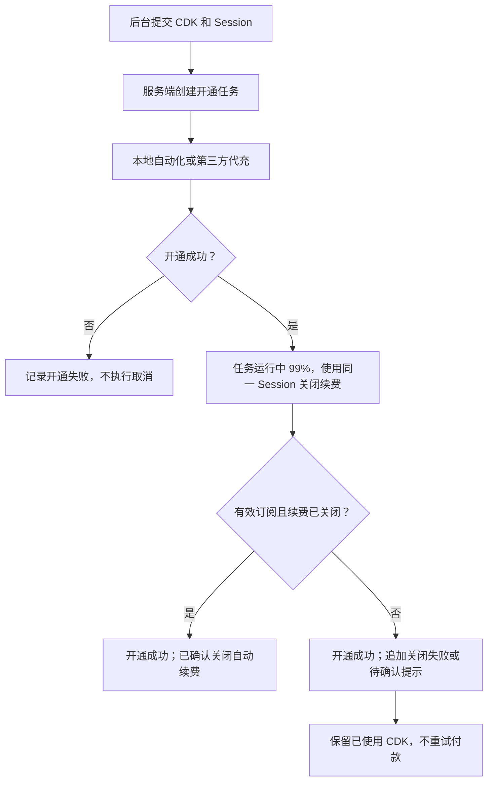

# 后台手动开通成功后自动关闭续费

日期：2026-11-09

## 行为

后台“Session 管理 → 手动启动自助开通”提交 CDK 和 Session 后，服务端确认开通成功，再使用同一 Session 和本次开通的代理关闭自动续费、查询状态。本地 Playwright 自动化和第三方代充模式均适用。

关闭续费处理期间任务保持 `running`、进度 99%；完成核验后才发布最终成功消息。只有查询到有效订阅且 `autoRenewRaw === false` 才报告已确认关闭。当前周期权益保留。

- 开通失败：不执行自动取消，保留原开通失败处理。
- 开通成功、关闭已确认：任务成功，消息包含“已确认关闭自动续费”。
- 开通成功、关闭失败或尚未确认：任务仍成功，消息追加关闭失败／待确认提示；CDK 保持已使用，不重试付款。
- 已经关闭续费：复用既有幂等检查，不重复发送取消请求。

## 修改位置

- `server.js`：共同开通入口对后台手动开通启用 `cancelAutoRenewOnSuccess`，复用现有开通后续费处理。
- `public/admin.html`：在手动开通表单注明自动关闭续费；修复成功提交后调用不存在的 `loadAdminData()`，改用现有 `loadData()`，恢复跳转运行日志。
- `test/activation-renewal.test.js`：覆盖后台路由策略及本地／第三方两个完整任务分支，验证续费确认前不提前结束、续费失败不回滚 CDK 或重复付款、开通失败不取消续费。
- `test/admin-ui.test.js`：Chromium 实际点击手动开通按钮，确认请求只提交一次、说明可见、正常跳转运行日志且无假错误。
- `README.md`：更新原先“后台不自动取消”的说明。

## 验证结果

- `npx vitest run test/activation-renewal.test.js test/post-activation-renewal.test.js --reporter=dot --silent`：51 项通过。
- `npm test -- --reporter=dot --silent`：30 个文件、437 项全部通过，耗时 49.46 秒，包含新增 Chromium 点击测试。
- `node --check` 检查服务端及改动的测试文件；`git diff --check` 无异常。

## 验证边界

使用本地测试和 Chromium；开通、订阅服务及数据库使用测试替身，不使用真实账号，不执行真实扣款或取消。未提交、推送或部署。

同步修改后的服务端及页面到当前 Docker Compose 部署目录后，执行 `docker compose restart app` 加载新的服务代码，并刷新后台页面。
