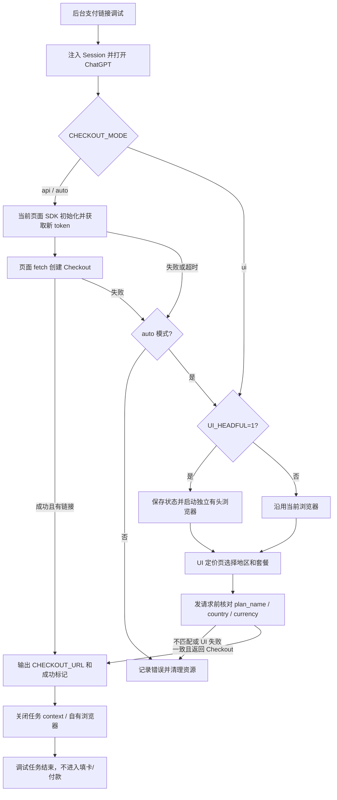
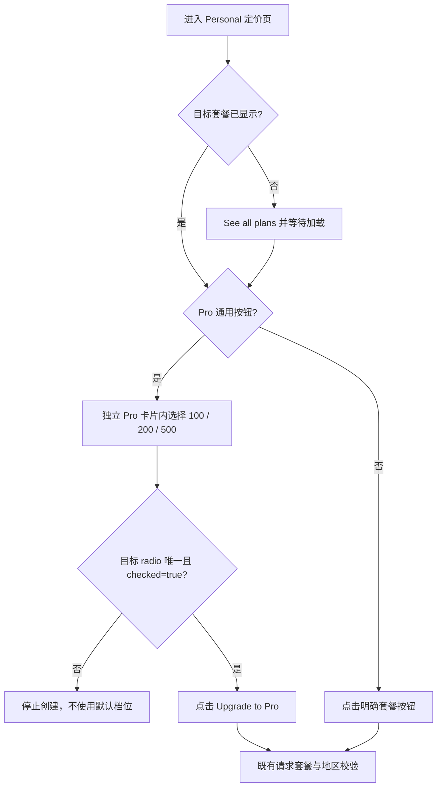
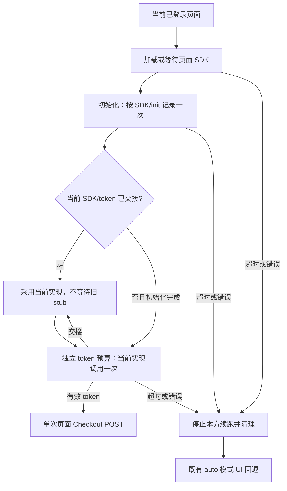
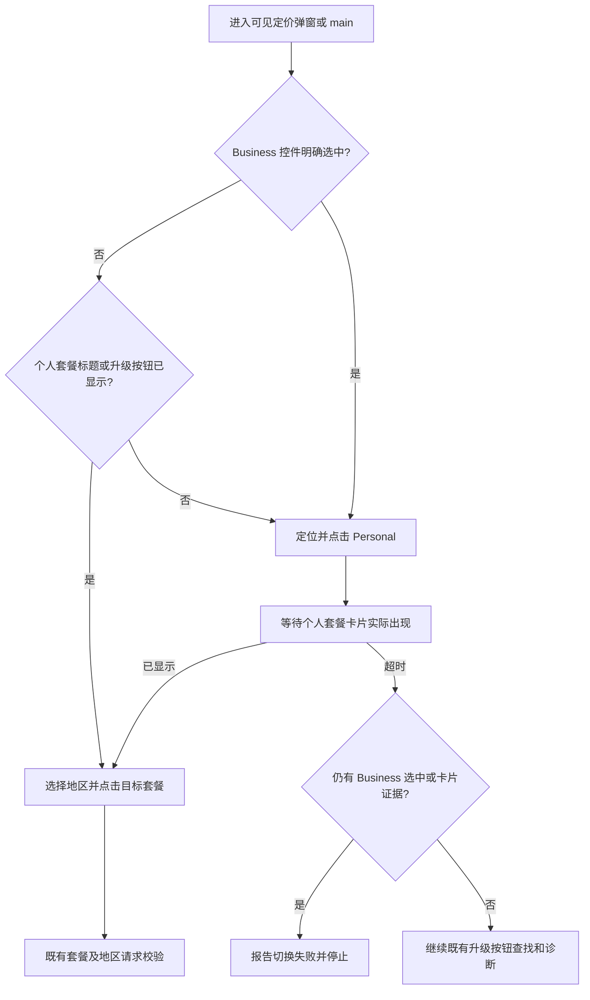

# Checkout 调试：页面 SDK 请求与有头 UI 回退

日期：2026-11-01

## 现象与已确认原因

用户报告：

```text
API 创建 Checkout 失败: Our systems have detected unusual activity. Please try again later.
```

源代码中确认了两个独立问题：

1. 当前调试链路使用 `context.request.post`，没有接入页面的 Sentinel SDK。
2. `index.js` 的 `debugOnly` 异常分支立即抛错，导致已有 UI 备用流程永远无法执行；`server.js` 又强制设置 `CHECKOUT_MODE=api`。

这证明了请求上下文和回退链路的缺失，**不证明**上游拒绝仅由 Sentinel 引起。
本次没有使用实际账号 Session，也没有创建真实 Checkout 或提交付款。

## 实现



### 请求

- `src/checkout/checkout-browser-request.js`：复用 `https://chatgpt.com` 当前页面；需要时加载站点 SDK。
- 使用 `init('chatgpt_checkout')` 和 `token('chatgpt_checkout')`。初始化后重新读取 `window.SentinelSDK`，避免调用被替换的 loader stub。
- 将 token 放入 `openai-sentinel-token`，通过页面 `fetch` 和 `credentials: include` 发送请求。
- device/account ID 仅取当前 Cookie 或会话，不生成随机值。
- SDK 和 API 都有超时；空 token、脚本加载失败、HTTP 错误或缺少链接不会记为成功。
- 原无页面 axios 辅助函数仍是兼容接口；后台调试实际走页面请求，并非该辅助函数。

### 回退与清理

- `CHECKOUT_MODE=auto` 默认 API 优先、失败后回退一次 UI。
- `CHECKOUT_MODE=api` 为明确的 API-only；`ui` 为 UI-only。
- 默认 `CHECKOUT_UI_HEADFUL=1`，独立启动有头 Chromium，不把已有的无头池当成有头浏览器。
- 保存 Cookie/localStorage，重新安装 Session 路由并恢复本次更新后的 Cookie；代理、区域、录像设置保留。
- 有头实例分配独立 CDP 端口，避免碰撞池端口。
- 初始浏览器/Session 安装失败也进入资源清理；关闭录像时仍关闭任务 context。
- UI 创建前核对实际请求的套餐与地区，避免两个 Pro 档位共用按钮造成静默换档。

### 部署

详见 `DEPLOY.md` 的 Checkout FAQ。Docker 镜像新增 Xvfb/xauth 和入口脚本，必须重建 app 镜像；Xvfb 不提供远程桌面。

## 验证记录

### 自动测试

```bash
npm test
```

结果：6 个测试文件，43 项通过。

- 修改前，实际 worker 的回归测试复现了 API 错误后 UI 调用次数为 0，以及 UI-only 调试直接失败。
- 修改后覆盖 API 成功、auto 回退、有头池绕过、API-only、UI-only、SDK 加载/超时/空 token、loader 对象替换、失败不误报成功、资源清理和套餐地区校验。
- worker 测试执行真实 `index.js` 控制流，浏览器/数据库/付款依赖被隔离；并断言调试中不会调用付款函数。

### 真实浏览器与容器

- Playwright 真实 Chromium：拦截测试页、SDK 和 Checkout 请求，验证相同会话 Cookie/device、SDK header，以及请求次数。未发送真实上游 Checkout。
- 真实独立有头 Chromium：验证跳过 pool、CDP Browser 信息不是 Headless、浏览器正常关闭。
- 真实 Chromium 路由：错误 Pro 档位在网络前中止，匹配档位继续到会话 context 路由。
- Debian Node 容器：验证入口脚本创建活跃 Xvfb socket、`XVFB_ENABLED=0` 跳过、已有 DISPLAY 保留；临时容器已清理。
- `node --check`、`sh -n`、`docker compose config --quiet`、`git diff --check` 通过。
- `package-lock.json` 未改变。

### 公开接口证据

2026-11-01 获取的站点 SDK loader 返回 HTTP 200，并声明 `SentinelSDK.init` / `SentinelSDK.token`：

- https://chatgpt.com/backend-api/sentinel/sdk.js
- 当日 loader 指向：https://chatgpt.com/sentinel/20260810913b/sdk.js
- `chatgpt_checkout` flow 和 header 的社区用例：https://linux.do/t/topic/3103524

生产代码使用 loader，不硬编码带日期的实现地址。公开用例不是稳定 API 契约。

## 尚未验证

- 用户实际 Session、账号、代理环境下是否不再出现 `unusual activity`。
- 当日真实定价页 DOM 是否匹配现有 UI 选择器，尤其是 Pro 档位和自定义 `plan_name`。
- 完整生产镜像重建（含原项目的 Python/ML 依赖）和部署后的端到端运行；本次只验证了 Xvfb 入口行为与配置格式。

线上最终判定：后台调试任务返回真实 `CHECKOUT_URL` 和 `CHECKOUT_DEBUG_SUCCESS`，且该链接与请求的套餐/地区一致。不能把单纯 HTTP 200 或本地 fixture 通过当作线上完成。

## 补充更正：创建会话与后续确认不是同一步

2026-11-01 再次核对用户提供的两份 HAR，均未包含 `POST /backend-api/payments/checkout` 创建请求；其中一份仅有对已有 Checkout 会话的读取。因此，这些抓包不能证明创建请求缺少某个特定的 Sentinel 头，也不能确定 `unusual activity` 的根因。

- 移除了此前根据后续阶段猜测加入的额外 SDK 调用和硬编码客户端来源头；保留此前的 `chatgpt_checkout` 页面 SDK 路径，但未将它视为已在真实账号验证的解决方案。
- 修复 UI 回退时，创建失败响应在点击返回之后才到达而导致错误详情丢失的竞态；响应体读取最多等待 1.5 秒，只展示已识别的异常活动提示和 HTTP 状态，不输出任意响应正文。
- HTTP 确认接口返回成功不等于已确认整个订阅完成。固定冷却时间、重试是否累计风险等也无法从现有 HAR 确认。

要进一步定位创建失败，需要从点击升级之前开始记录精确的创建请求，提供脱敏后的请求字段、响应状态和错误信息；不要包含 Cookie、令牌、卡片资料或其他支付凭据。

## 2026-11-02：浏览器创建请求实测

- 在已登录的 ChatGPT 免费套餐页面，通过官方升级界面观察到 `POST /backend-api/payments/checkout` 返回 HTTP 200，响应包含 `checkout_session_id` 和 `processor_entity`，`url` 为空。只记录字段名称、无敏感值的套餐/地区和状态；没有触发付款。
- 本次浏览器请求为 Plus、JP/JPY、`custom`。项目地区可配置，JP/JPY 不应被强制写为默认值。此成功样本无法说明另一次 `unusual activity` 的确切原因。
- 与项目原来的四字段载荷相比，浏览器创建载荷还包含 `cancel_url`、`checkout_appearance`、`checkout_source`、`purchase_attempt_id` 和 `supports_saved_payment_link`。由于这次没有保存它们的值，也没有失败请求作对照，不据此猜测字段内容或宣称它们是必需字段。
- 浏览器创建请求中同时出现 `oai-device-id` 和 `oai-did` 头；项目创建请求现在在页面存在有效 `oai-did` Cookie 时，将该 Cookie 的值作为 `oai-did` 请求头一并发送。此调整是协议差异对齐，并非已验证的风控修复。
- 当上游不返回链接时，代码现在根据响应中的 `processor_entity` 生成站内 Checkout 链接，并校验路径片段；响应未提供该字段时保留原有 `openai_llc` 默认值。响应没有有效链接时也不再把完整响应正文拼进错误日志。这些均是成功响应解析问题，与上游 400/403 风控是不同阶段。

本轮没有在原结账页调用最终确认，也没有针对项目的真实账号/部署环境执行 API 创建请求；仍需实际项目失败日志与同账号、同配置的成功/失败请求对照，才能判断 `unusual activity` 是否已经解决。

## 2026-11-02：用户 HAR 对照与账号头修正

- `/Users/yukaijun/Downloads/chatgpt.har` 中有一次创建请求：HTTP 200，返回了会话 ID；没有复现 `unusual activity`。请求为 Plus、JP/JPY、custom，不代表项目部署一定使用相同地区或网络。
- 成功请求中，`oai-did` 与 `oai-device-id` 相等，也与设备 Cookie 和 Sentinel 的 `id` 一致；`chatgpt-account-id` 与该请求的访问令牌中的账号标识一致。只比较相等关系，不记录任何实际标识、令牌或 Cookie。
- 发现代码在页面 bootstrap 存在但不含账号 ID 时，会忽略已注入 Session 中的账号 ID；如果 Session 也没有账号字段，则不会采用当前令牌里的账号标识。现按页面 bootstrap、已注入 Session、令牌 claim 的顺序选择有效账号 ID，无可用值时不发送。令牌解析只是提取请求上下文，不是本地签名验证或身份授权。
- 新增脱敏诊断行 `[Checkout] 请求上下文`，仅记录账号标识来源、标识与令牌是否一致、设备头/设备 Cookie 是否存在、Sentinel flow/设备是否匹配；不会输出实际标识或令牌。
- 该成功样本还出现 `checkout_appearance=light`、`checkout_source=chatgpt_web_merged` 和其他可选字段。由于没有对应失败请求，不能证明它们为风控拦截原因，也没有据此强行改写套餐、地区或支付相关配置。

本地测试能复现并覆盖账号头缺失和脱敏诊断，但无法重现上游风控。部署到实际环境后，应查看最终状态以及脱敏的 `[Checkout] 请求上下文`；出现 API 失败日志并不必然代表自动 UI 回退也失败。

## 2026-11-02：精简套餐页展开与 Pro 数字档位选择

用户提供的页面截图显示，初始 Personal 视图可能仅显示 Free / Plus，点击 `See all plans` 才会显示 Go / Pro。Pro 的三个档位共用 `Upgrade to Pro` 按钮，档位由数字 radio 控制：

| 本地套餐 | radio 名称 | 请求 plan_name |
| --- | --- | --- |
| pro_10x | 100 | chatgptprolite |
| pro_20x | 200 | chatgptpro |
| pro_50x | 500 | chatgptpromax |

- `src/checkout/pricing-checkout.js`：Go / Pro 共用展开和异步等待；不依赖易变的 CSS 类名。
- 通用 Pro 升级按钮必须唯一，并在其最近的独立 Pro 卡片内精确定位档位。点击 radio 后等待 `aria-checked=true`，兼容异步卡片重绘。缺档、重复、禁用或选中状态未更新时停止，不尝试默认档位或其他套餐。
- 保留已有的明确标注 `Pro 10X / 20X / 50X` 的专属按钮路径；不恢复 Pro 5X。
- 创建请求继续校验 `plan_name / country / currency`，不通过改写请求来掩盖页面选错档位。



验证：新增的三个档位测试在修复前均复现了“直接点击当前档位”，修复后通过。真实 Chromium 的本地 DOM 测试还覆盖精简页展开、延迟 radio、整卡重绘、已选中、缺档、禁用、状态未更新、重复卡片及卡片外数字干扰。`npm test -- --reporter=dot --silent`：19 个文件、207 项测试通过；语法检查和 `git diff --check` 通过。

本轮未访问真实订阅页、未创建真实 Checkout、未付款；没有修改 Sentinel 超时处理。本地选择器验证不代表线上风控已解决，也不代表代码已推送或部署。

## 2026-11-02：Sentinel SDK 异步交接与超时生命周期修复

### 可重复的代码缺陷

在实际 `requestBrowserCheckout` 的 VM 回归中，旧实现出现四项失败：`init` 返回 void 后延迟替换 SDK、旧 `init` 一直 pending 但 SDK 已替换、token 函数原位替换、初始化超过超时后仍迟到调用 token。前两种初始化行为是同类交接缺陷的两个变体。

这些结果证明本地代码存在异步缺陷，不证明线上日志中的全部超时均由它们导致；上游资源加载、代理出口和账号状态仍可能独立失败。

### 修改

- `src/checkout/checkout-browser-request.js`：按 `(SDK 对象, init 函数)` 保存初始化状态，按 `(SDK 对象, token 函数)` 保存 token 状态。轮询当前实现引用，旧 Promise 不阻塞新实现，同实现不会被周期性重调。
- `init` 原位安装新 token 不触发重复初始化；pending loader init 在 token 交接后不再阻塞，也不会因旧 init 迟到 rejection 推翻新实现。
- SDK 加载/初始化和 token 生成分开计时，默认各 30 秒；同阶段使用绝对 deadline，反复交接不会延长预算。已有显式配置保持优先。
- 结束时清理本方定时器、注入脚本处理器；失败时只移除自己创建的脚本，不删除页面已有脚本。第三方 Promise 或脚本本身可能继续执行，但本方不会因此继续调用 token 或提交 Checkout。
- 保留单次 Checkout API POST、同页面 Cookie/代理/网络栈和既有 `auto` UI 回退。没有增加自动重发、缓存/伪造 token 或其他厂商 token。
- `src/checkout/chatgpt.js`：成功时输出阶段耗时与交接次数；失败只含固定错误、阶段和耗时，不透传 SDK 异常正文或 token。

Alibaba 等 SDK 的异步加载模式只能作为工程设计参考。本轮没有接入 Alibaba SDK，也没有将其风控协议或 token 混用于 Sentinel。



### 验证

```bash
npx vitest run test/checkout-browser-request.test.js test/sentinel-browser-lifecycle.test.js --reporter=dot --silent
npm test -- --reporter=dot --silent
git diff --check
```

- 定向测试：两个文件、57 项通过。包含预算边界、重复交接、SDK 接收者 `this`、pending/迟到 rejection、脚本所有权和清理、单次 POST、不输出私密错误正文。
- 全量测试：20 个文件、229 项通过；修改文件的 Node 语法检查和 `git diff --check` 通过。
- 真实 Chromium 的四项测试拦截全部网络，仅使用本地响应和全新 context：pending init 交接、token 原位交接、超时后脚本确实执行但不续跑、token 迟到结果不提交；无真实 Cookie 或实际 Checkout。
- 未在真实账号上验证上游 Sentinel 是否签发 token，未提交真实支付；因此不能将本地测试或健康检查等同于线上风控已通过。

## 2026-11-09：Personal / Plus 页面被误判为 Business

### 现象与复现

任务在进入定价页后退出，报错“定价页停留在 Business 套餐，未能切换到 Personal，无法购买 Plus/Pro”。截图显示 Personal 已选中、Free / Plus 卡片和 `Upgrade to Plus` 按钮可见。

在本地 Chromium 中保留截图的精简布局、仅增加页面其他位置或卡片下方的 `ChatGPT Business` 链接/宣传文案，旧代码即可复现相同异常。仅含截图可见元素的布局原本可以通过；截图本身不足以确定失败时完整 DOM。本地没有日志所指的容器录像文件，本轮未回放该线上任务。

已确认的代码缺陷：

- `isBusinessTabActive` 将全页 `ChatGPT Business` 文案作为 Business 选中依据，只有旧标题 `ChatGPT Plus` 能抵消该判断。新版标题 `Plus` 不匹配，且此判断会提前跳过实际存在的 Plus 升级按钮。
- `switchToPersonalPlans` 仅凭 Personal 的 ARIA 选中状态提前返回；React 可能先更新标签，再异步替换套餐卡片。原有 `isVisible({ timeout })` 调用不会等待卡片加载。

### 修复

- 识别范围限定在可见定价弹窗或可见 `main`，忽略隐藏旧弹窗及背景页面。
- Business 标签依据明确选中状态判断，支持 tab/button/radio、`aria-selected` / `aria-pressed` / `aria-checked`、`data-state` 和原生 radio。
- Personal 内容兼容 `Plus` / `ChatGPT Plus`、Go、Pro 卡片及对应升级按钮；非选中的 Business 标签或宣传文案不再覆盖个人套餐证据。匹配时检查所有候选，避免隐藏的首个节点遮蔽可见卡片。
- 点击切换后轮询实际套餐内容，默认最多等待 8 秒；已选中的 Personal 仍需等卡片出现，不重复点击。真实 Business 选中状态或 Business 卡片且没有个人套餐内容时，仍保留错误。
- Checkout 的套餐、国家、币种请求校验保持原逻辑。



### 验证与生效

```bash
npx vitest run test/pricing-personal-ui.test.js --reporter=verbose --silent
npm test -- --reporter=dot --silent
node --check src/checkout/pricing-checkout.js
node --check test/pricing-personal-ui.test.js
git diff --check
```

- 修复前首轮 8 个 Chromium 场景中有 5 个失败，包含相同 Business 异常及标签先于卡片更新的竞态。
- 修复后新增 18 项 Chromium 回归全部通过，覆盖新版/旧版 Plus、Go/Pro、背景 Business 文案、可见弹窗、隐藏重复标题、不同切换控件、延迟渲染、原生 radio 及真实 Business 页面。
- 全量测试：29 个文件、399 项通过；语法和差异检查通过。
- 新增用例全部拦截外部网络；未使用真实 Session、未创建真实 Checkout、未付款。现有自动测试不能代表原线上任务已经成功。
- 本轮只修改本地代码，未推送或部署。当前 `docker-compose.yml` 将 `./src` 只读挂载到 `/app/src`；同步修复后，新启动的任务子进程会加载新代码。如需统一重启服务，在没有运行中任务时执行 `docker compose restart app`。没有源码挂载的部署需重新构建并替换 app 容器。已结束的失败任务需要重新提交。
