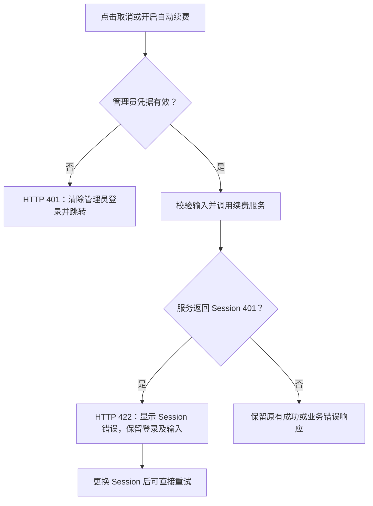

# 续费操作误退出管理员登录的修复

日期：2026-11-09

## 问题与根因

在后台“续费管理”点击“取消自动续费”后，如果提交的 ChatGPT Session 被上游拒绝，订阅服务返回 `statusCode: 401`。原路由直接将这个状态作为 HTTP 401 返回。

前端共用的 `authFetch()` 将 HTTP 401 解释为管理员登录失效，调用 `redirectToLogin()` 清除 `plus_admin_token` 并跳转登录页。因此，业务 Session 失效会误退出仍然有效的管理员登录。“开启自动续费”接口也存在相同问题。

## 修改

仅修改 `server.js` 的两个路由失败分支：

- `POST /api/admin/subscription/cancel-auto-renew`
- `POST /api/admin/subscription/enable-auto-renew`

将订阅服务返回的 401 转为 HTTP 422，并附带 `code: CHATGPT_SESSION_EXPIRED` 和 `upstreamStatus: 401`，保留原错误提示。管理员鉴权中间件仍然使用 HTTP 401，前端的全局鉴权行为保持原样。其他业务错误状态和成功响应保持原样。



## 回归验证

新增 `test/admin-renewal-auth.test.js`，共 27 项测试。接口测试使用真实 Express 路由及管理员鉴权，模拟数据库和续费服务。Chromium 集成测试使用真实后台 HTML 和 HTTP 路由，外部请求均在本地拦截，不执行真实订阅操作。

覆盖取消和开启两个入口的 Session 失效、替换 Session 重试成功、空输入、管理员凭据缺失／无效／撤销、其他业务错误及成功响应。页面测试检查不误跳转、管理员 token 和输入保留、错误提示可见、按钮恢复、没有假成功，以及真正管理员鉴权失败时仍退出。

验证命令：

```bash
npm test -- --reporter=dot --silent
node --check server.js
node --check test/admin-renewal-auth.test.js
git diff --check
```

本次全量测试结果：30 个测试文件通过，426 项测试通过，耗时 50.63 秒。

## 部署生效

当前仅完成本地修复和回归测试，未提交、推送或部署，也未使用真实账号执行取消或开启续费。

现有 `docker-compose.yml` 将 `server.js` 挂载到 `/app/server.js`。将修改后的文件同步到部署目录后，重启应用以加载新的 Node.js 服务代码：

```bash
docker compose restart app
```

没有挂载源码的部署需要重建并替换应用容器。服务器上线后的真实 Session 操作仍未验证。
